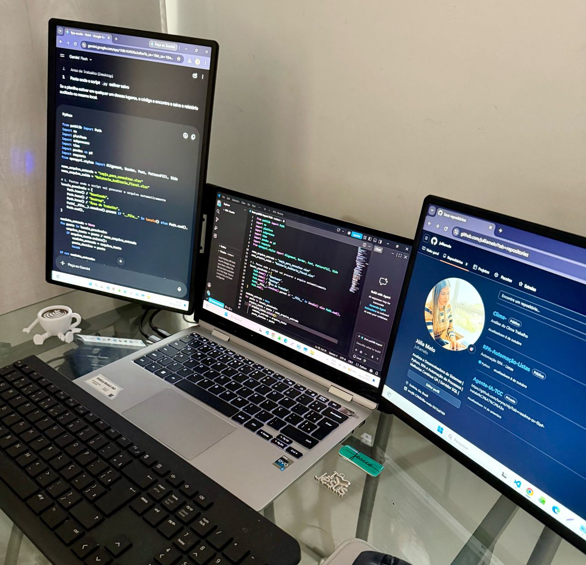
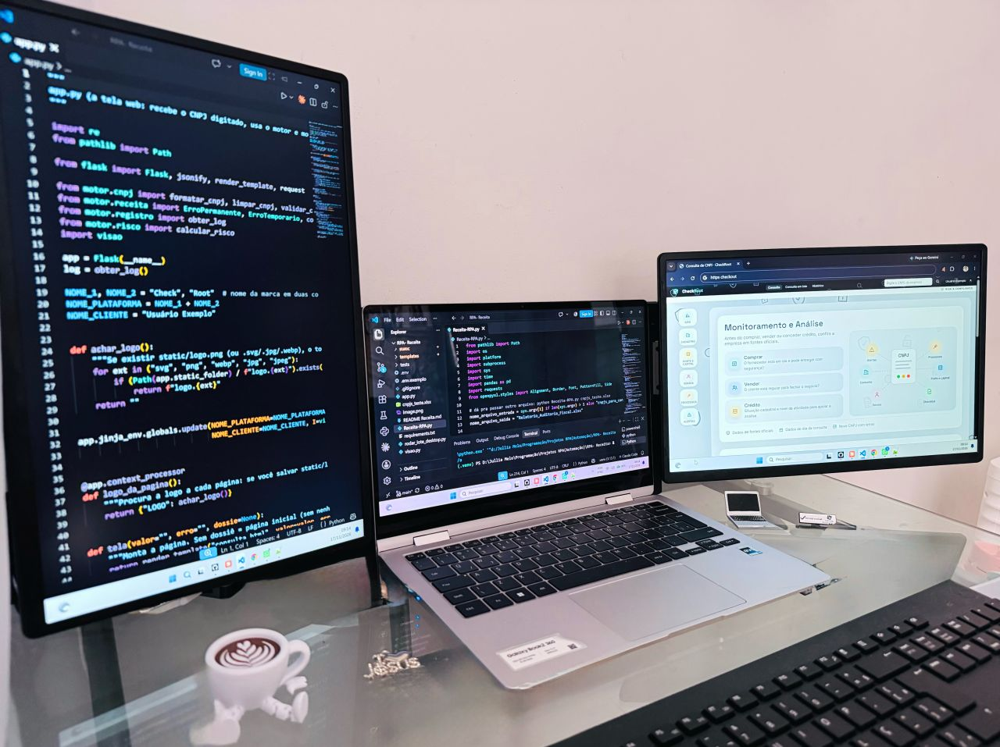

# CheckRoot · Risk & Compliance (vitrine do projeto)

> 📌 **Repositório de portfólio.** Mostra o que o projeto faz. O código completo fica em repositório privado. Mais projetos no [meu perfil](https://github.com/julliamelo).

Este repositório é só a vitrine. O código-fonte do projeto fica em um repositório privado. Se quiser conversar sobre ele, entre em contato.

## O objetivo

Ajudar a decidir com mais segurança **antes de comprar, vender ou conceder crédito**. A pessoa informa o CNPJ de uma empresa e recebe um dossiê organizado, com um semáforo de risco (verde, amarelo, vermelho ou cinza) e o motivo escrito de cada resultado.

## De onde veio

O projeto nasceu como um robô de automação: ele lia uma planilha com uma lista de CNPJs, conferia cada um em fontes públicas e entregava um relatório em Excel pronto para uso. Isso eliminava uma conferência manual, repetitiva e sujeita a erro.

## Onde estamos agora

O robô virou uma **plataforma com interface web**:

- **Página inicial** apresentando a plataforma.
- **Login com e-mail e senha**, para cada pessoa ter o seu espaço.
- **Painel** com o resumo das consultas já feitas e o histórico de cada usuário.
- **Dossiê da empresa** com cadastro, porte, sócios e saúde tributária, cada informação com a fonte e a data.
- **Consulta em lote** por planilha, com relatório em Excel.

## Princípios

- **Transparência:** o que ainda não foi consultado aparece como "não consultado". Nunca como "nada consta".
- **Privacidade (LGPD):** documentos de pessoas físicas aparecem mascarados.
- **Fontes públicas:** os dados vêm de bases públicas e oficiais, e a tela diz de onde cada um veio.

## Próximos passos

- Ligar mais fontes de conformidade (compliance).
- Exportar o dossiê em PDF e Excel.
- Versão para desktop.
- Novos módulos na plataforma, como prospecção de empresas.

## Tecnologia

Python no servidor e HTML, CSS e JavaScript na interface.

## Veja nas publicações

O projeto teve boa recepção no LinkedIn. Cada publicação mostra uma parte dele:

### Publicação 1: o robô que consulta CNPJ

[Ver a publicação no LinkedIn](https://lnkd.in/p/dMwdxbUY)

### Publicação 2: a plataforma CheckRoot

[Ver a publicação no LinkedIn](https://lnkd.in/p/ddpQVW5M)

## Situação

Em desenvolvimento.
