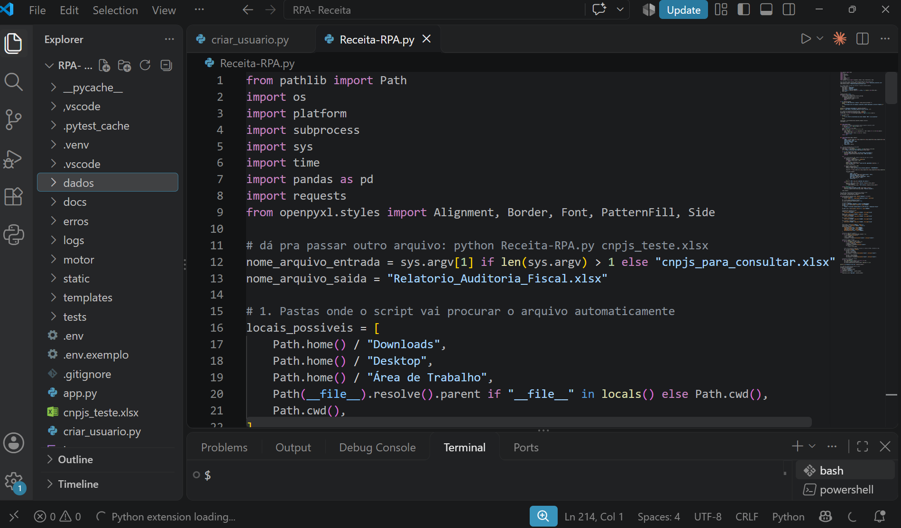
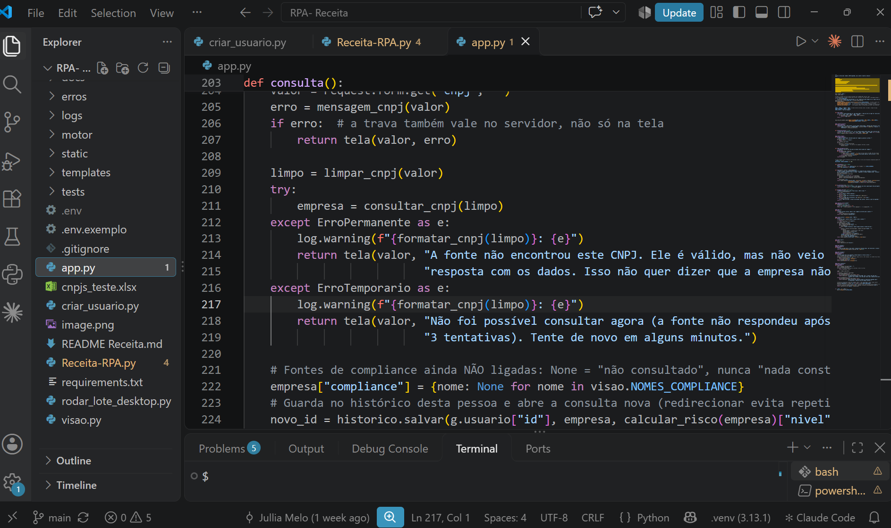

# CheckRoot · Análise de CNPJ Dados da Receita e outras fontes via API pública

Digite um CNPJ e receba um dossiê da empresa, montado a partir de fontes públicas, para apoiar decisões de **compra, venda e crédito**.

> **Repositório de portfólio.** Mostra o que o projeto faz. O código-fonte fica em um repositório privado.

## Como surgiu este Desenvolvimento (case)

Este **case** surgiu de uma **necessidade que acompanhei de perto na cooperativa**: várias áreas precisam conferir uma empresa antes de decidir. Vi isso na prática, analisei em detalhe e percebi que podia melhorar.

Identifiquei uma **oportunidade de melhoria**: reunir informações de fontes públicas, reduzindo o gasto com dados e concentrando o investimento em desenvolvimento e manutenção. A cada etapa surgem novas necessidades, e a solução evolui junto.

O objetivo é reunir em um só lugar as informações que ajudam organizações de diferentes segmentos a **decidir com mais segurança**, com uma solução em **melhoria contínua**.

## Para quem o projeto ajuda

| Área | Como ajuda |
|---|---|
| **Crédito** | Apoio na análise antes de conceder |
| **Comercial e vendas** | Conhecer a empresa antes de visitar ou negociar |
| **Cadastro** | Confirmar os dados da empresa |
| **Compras e fornecedores** | Conferir antes de fechar contrato |
| **RH** | Conferir antes de contratar palestra, treinamento ou consultoria |
| **Risco e compliance** | Ver os pontos que pedem verificação |

## Código

### Robô de consulta da Receita

Onde o projeto começou: lê uma planilha de CNPJs, consulta cada empresa e gera um relatório em Excel.

### Interface web

A aplicação que recebe o CNPJ e mostra o dossiê.

## O que o dossiê entrega

### 🏢 Identificação
- CNPJ
- Razão social
- Nome fantasia
- Matriz ou filial
- Situação cadastral

### 📅 Perfil da empresa
- Data de abertura
- Porte
- Capital social
- Faixa de faturamento pelo porte (não é o faturamento real)

### 📋 Cadastro
- Atividades da empresa
- Natureza jurídica
- Endereço

### 🧾 Situação tributária
- Simples Nacional
- MEI

### 👥 Quadro de sócios
- Nome e qualificação
- CPF mascarado
- Data de entrada na sociedade

### 🚦 Análise de risco
- Semáforo com o motivo por escrito e a fonte

## Duas formas de usar

O projeto tem **duas frentes**, para necessidades diferentes: a plataforma web e a interface desktop.

| | Plataforma web | Interface desktop |
|---|---|---|
| **Para quando** | Ver o dossiê na tela e guardar o histórico | Precisar de um resultado rápido |
| **Como entra** | Login e senha, depois o CNPJ | Um CNPJ ou um Excel com vários |
| **O que sai** | Dossiê na tela | Arquivo em Excel ou PDF |
| **Situação** | Em desenvolvimento | Planejada |

### Interface desktop: rápida e direta

Será um aplicativo mais simples, para onde não é preciso uma plataforma e o importante é a rapidez:

1. A pessoa digita **um CNPJ** ou faz a consulta **em lote**, com muitos de uma vez.
2. O aplicativo busca as informações.
3. O arquivo é baixado automaticamente, em **Excel ou PDF**.

*Frente planejada, ainda a ser desenvolvida.*

## Confiabilidade e segurança

- **Retorno de erros:** quando uma consulta falha, o sistema avisa o que houve e registra em **log**, para a causa ser identificada.
- **Transparência:** o que não foi consultado nunca aparece como "nada consta".
- **Acesso:** somente usuários cadastrados, hoje em servidor próprio.
- **LGPD:** CPF de pessoas físicas aparece mascarado.

## O que está em desenvolvimento

O login com e-mail e senha está pronto. Estamos finalizando a integração da interface com o layout, ligada às informações da Receita Federal por meio do motor do projeto.

| Frente | Em andamento |
|---|---|
| **Interface e layout** | Definir o layout final das informações e integrar as telas |
| **Dados e motor** | Ligar as informações da Receita Federal às telas e incluir novas informações e APIs |
| **Qualidade (QA)** | Testes para encontrar erros e bugs |
| **Próximas entregas** | Download em PDF e Excel, interface desktop e acesso externo seguro |

## Tecnologias

| Tecnologia | Para que é usada |
|---|---|
| **Python** | Linguagem principal do projeto |
| **Flask** | Biblioteca do Python que cria o site no servidor |
| **requests** | Faz as consultas às fontes externas |
| **pandas** e **openpyxl** | Planilhas e relatórios em Excel |
| **HTML** | Estrutura das telas |
| **CSS** | Cores, fontes e aparência |
| **JavaScript** | Interação na tela |
| **SQL (SQLite)** | Usuários e histórico de consultas |
| **pytest** | Testes automatizados |

---

© 2026 Júllia Melo. Todos os direitos reservados.
